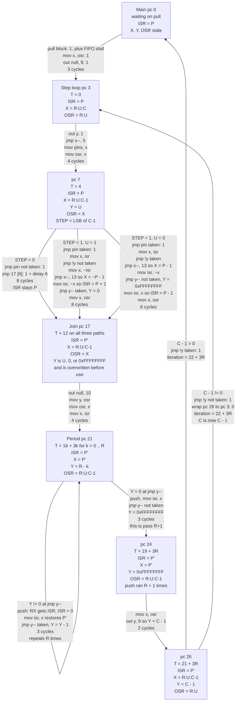

# Pico PIO program flow

[Back to README](../../README.md) | [Pico platform](platforms/pico.md)

State machine built by `stepper_make_program()` in `src/pd_pico/pico_pio.cpp`.
One FIFO word is one command. The machine peels that word, pulses the step
pin, updates the position held in the ISR, and pushes the position to the RX
FIFO while it waits out the step period.

`add_step` stores 27 instruction words (`program.pc` is 27). The source sets
`wrap_at = 26` and `wrap_target = 3` (`label_step_loop`). Wrap adds no cycle.

The direction pin is **not** in this program. `push_command()` writes that
GPIO after the FIFO put that carries the direction-changing command. The
program only carries the step pin (`mov pins`, `jmp pin`) and the up flag.

## Command word

OUT shifts the OSR to the right (SDK default). Low bits come out first.

```
bit 31                 10  9 8        0
    [ R, 22 bits       ][U][ C, 9 bits ]
```

| Field | Bits | Meaning |
| --- | --- | --- |
| `C` | 8:0 | Loop count. Pause: `C = 1`. Steps: `C = 2 * steps`. |
| `U` | 9 | `1` counts position up, `0` counts down. |
| `R` | 31:10 | Period. Y starts here for the wait loop. |

`pio_make_fifo_entry` builds `(R << 10) | (U << 9) | C`.

After `C` is decremented, the step pin is the new LSB of `C`:

* `C` even → LSB becomes 1 → position is updated (high half of a step).
* `C` odd → LSB becomes 0 → position is left unchanged (low half, or a pause).

A step command therefore runs `2 * steps` iterations. A pause runs one
iteration and never takes the position update.

Pins, from `StepperQueue::setupSM()`:

* `mov pins` / OUT pins: the step GPIO, one pin.
* `jmp pin`: the same step GPIO.
* No `set pins`: the direction pin is a CPU GPIO.

## Cycle rules

Each stored instruction takes one cycle, plus its delay field. `jmp 17 [6]`
is seven cycles. A blocking `pull` with an empty TX FIFO stalls for as long
as the FIFO stays empty; the stall is outside the counts below.

`jmp x--` and `jmp y--` test the register, then decrement it either way.
The jump is taken when the value was non-zero before the decrement. A
register that was 0 becomes `0xFFFFFFFF` and the jump is not taken. Counting
up inverts the position, decrements, and inverts again, so a decrement of 0
has to underflow. That is what turns position `0xFFFFFFFF` into 0.

## Loaded program

| pc | Instruction | Cycles | Next |
| --- | --- | --- | --- |
| 0 | `pull block` | 1 | 1. Main loop. OSR becomes the FIFO word. |
| 1 | `mov x, osr` | 1 | 2 |
| 2 | `out null, 9` | 1 | 3. Drops `C`. |
| 3 | `out y, 1` | 1 | 4. Step loop. `Y = U`. |
| 4 | `jmp x--, 5` | 1 | 5. `X = X - 1`. |
| 5 | `mov pins, x` | 1 | 6. STEP = LSB of `X`. |
| 6 | `mov osr, x` | 1 | 7 |
| 7 | `jmp pin, 9` | 1 | 9 if STEP is 1, else 8. |
| 8 | `jmp 17 [6]` | 7 | 17. Pause path; same length as the position update. |
| 9 | `mov x, isr` | 1 | 10 |
| 10 | `jmp !y, 12` | 1 | 12 if `U = 0`, else 11. |
| 11 | `mov x, ~isr` | 1 | 12. Count up. |
| 12 | `jmp x--, 13` | 1 | 13. `X = X - 1`, including 0 → `0xFFFFFFFF`. |
| 13 | `mov isr, ~x` | 1 | 14 |
| 14 | `jmp y--, 16` | 1 | 16 if `Y != 0`. `Y` decrements either way. |
| 15 | `mov isr, x` | 1 | 16. Count down keeps `X` rather than `~X`. |
| 16 | `mov x, osr` | 1 | 17 |
| 17 | `out null, 10` | 1 | 18. Join. OSR becomes `R`. |
| 18 | `mov y, osr` | 1 | 19. `Y = R`. |
| 19 | `mov osr, x` | 1 | 20 |
| 20 | `mov x, isr` | 1 | 21. `X = P`. |
| 21 | `push` | 1 | 22. RX FIFO gets the ISR, then the ISR is 0. |
| 22 | `mov isr, x` | 1 | 23. ISR restored. |
| 23 | `jmp y--, 21` | 1 | 21 while `Y` was non-zero. |
| 24 | `mov x, osr` | 1 | 25 |
| 25 | `out y, 9` | 1 | 26. `Y = C - 1`. |
| 26 | `jmp !y, 0` | 1 | 0 if `Y = 0`. Otherwise wrap to 3. |

The patch `program.code[8] |= 17` is what makes the pause path land on the
join at pc 17.

`T` in the diagram is the number of cycles since entering pc 3 on this
iteration.

## Flow

`W` means the full word `R:U:C`. After an OUT, the same notation is the
fields still in the OSR, with the rightmost field in the LSB. `P` is the
position in the ISR. `P'` is `P` after the optional update (`P + 1`, `P - 1`,
or `P`).



## Parallel paths

Cycles from step-loop entry to the join:

| Path | pc 3–6 | `jmp pin` plus body | Arrival |
| --- | --- | --- | --- |
| STEP = 0 | 4 | `1 + 7` = 8 | T = 12 |
| STEP = 1, `U = 1` | 4 | `1 + 7` = 8 | T = 12 |
| STEP = 1, `U = 0` | 4 | `1 + 7` = 8 | T = 12 |

The three position paths meet at T = 12. `Y` differs across those paths.
`mov y, osr` at T = 13 replaces it with `R` before `Y` is read again.

The exit to main and the wrap back to the step loop both spend one cycle on
`jmp !y`. The wrap adds nothing further, so both ends of an iteration are
`22 + 3R` cycles.

## Timing

One step-loop iteration, from pc 3 back to pc 3 or on to pc 0:

| Piece | Cycles |
| --- | --- |
| pc 3–6 | 4 |
| `jmp pin` and the position body (or the pause jump) | 8 |
| Isolate `R`, copy it to `Y`, restore OSR and `X` | 4 |
| Period body, executed `R + 1` times | `3R + 3` |
| `mov x`, `out y, 9`, `jmp !y` | 3 |
| Wrap, only if `C - 1 != 0` | 0 |
| Total | `22 + 3R` |

`jmp y--` is why the body runs `R + 1` times. The extra pass is the `+ 3`
inside the 22. `R = 0` still pushes the position once.

Once per FIFO word, before the first step-loop entry, the machine runs
`pull`, `mov x, osr`, and `out null, 9` (3 cycles, plus any pull stall).
With the next word already waiting, the time from one `pull` to the next is

```
3 + loop_cnt * (22 + 3R)
```

`pio_calc_loops` budgets `loop_cnt * (22 + 3R)` and leaves those 3 cycles
outside the budget. Step commands all go through that function.

`LOOPS_FOR_1US` is `(80 - 3 - 22) / 3`, which is 18. It is used only in
`StepperQueue::getCurrentStepCount()`, and only when the state machine is
idle. The call queues one pause (`steps = 0`, so `C = 1`) to make the program
push the position already held in the ISR. `getCurrentPosition()` and the idle
`pos_offset` capture in `add_queue_entry` reach it through that function. The
pause length does not change the position word. At 80 MHz that one-iteration
pause is `3 + 22 + 3 * 18` = 79 cycles. The 1 µs pause is therefore one cycle
short; `pio_calc_loops` carries the difference in `adjust_80MHz`.

The direction pin timing is outside this budget. `push_command()` writes the
GPIO after the FIFO put of the direction-changing command, with four
old-direction pause words ahead of it in the pipeline (one command in flight,
three in the TX FIFO). See `addDirChangePauseToQueue()` in
`src/pd_pico/pico_queue.h`.
